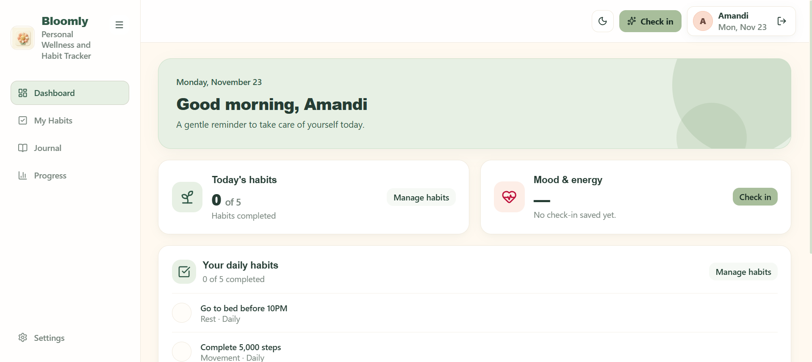
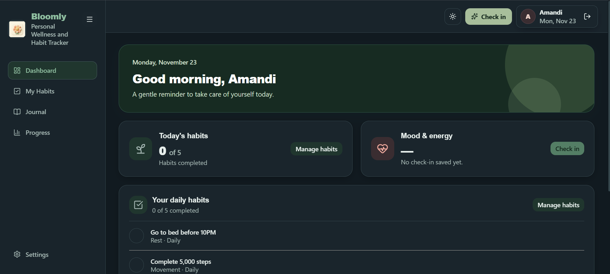
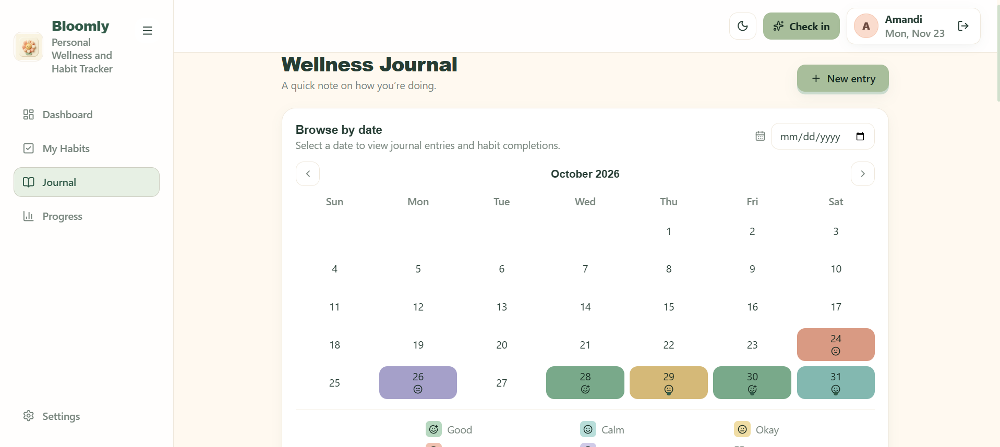
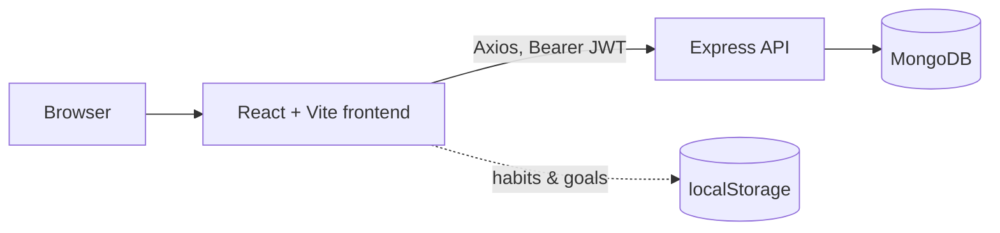

# 🌱 Bloomly – Personal Wellness & Habit Tracker

Bloomly is a full-stack web app for building healthy routines. Users log their daily mood and energy, track habits, keep a wellness journal and review their progress over the week, all in one calm, minimal interface.

**🔗 Live demo:** https://bloomly-delta.vercel.app

<p align="center">
  
  
</p>
<p align="center"><em>Dashboard: light and dark mode</em></p>

<p align="center">
  
</p>
<p align="center"><em>Wellness journal: calendar with colour-coded daily moods</em></p>

---

## ✨ Features

| Area | What you can do |
|---|---|
| **Dashboard** | Personalised welcome, today's habit checklist, quick daily mood & energy check-in |
| **Habits** | Create habits with a category (Mindfulness, Hydration, Movement, Rest, Nutrition, Focus, Other), a frequency and an optional preferred time; archive and restore them |
| **Journal** | Calendar view of entries; record mood, energy (1–5), study hours, a "little win", self-care activities and notes; edit or delete entries |
| **Insights** | Weekly mood distribution, average energy and check-in count (charts with Recharts) |
| **Progress** | Habit completion for the last 7 days, per-habit history and personal goals |
| **Settings** | Update profile, set a preferred check-in time, toggle light/dark theme, log out |
| **Auth** | Sign up / log in with email and password (bcrypt-hashed), JWT-protected API routes |

## 🛠 Tech Stack

- **Frontend:** React 19, Vite, React Router, Tailwind CSS, Recharts, Axios, Lucide icons
- **Backend:** Node.js, Express 5, Mongoose
- **Database:** MongoDB
- **Auth:** JSON Web Tokens, bcryptjs
- **Deployment:** Vercel (frontend and serverless API)

## 🏗 Architecture



### API endpoints

| Method | Endpoint | Auth | Description |
|---|---|---|---|
| POST | `/api/auth/signup` | – | Create an account |
| POST | `/api/auth/login` | – | Log in, returns a JWT |
| GET | `/api/auth/me` | ✅ | Get the current user's profile |
| PUT | `/api/auth/me` | ✅ | Update profile / settings |
| GET | `/api/logs` | ✅ | List the user's daily logs |
| POST | `/api/logs` | ✅ | Create a daily log |
| PUT | `/api/logs/:id` | ✅ | Update a log |
| DELETE | `/api/logs/:id` | ✅ | Delete a log |

## 📁 Project Structure

```text
bloomly/
├── backend/
│   ├── api/index.js        # Vercel serverless entry point
│   ├── server.js           # Local Express server
│   ├── middleware/auth.js  # JWT verification
│   ├── models/             # Mongoose models (User, Log)
│   └── routes/             # auth.js, logs.js
└── frontend/project/
    └── src/
        ├── pages/          # Dashboard, Habits, Journal, Insights, Progress, Settings, Login, Signup
        ├── components/     # Reusable UI (cards, modals, badges…)
        ├── services/       # dataService.js – API and storage layer
        └── api.js          # Axios instance
```

## 🚀 Getting Started

**Prerequisites:** Node.js 20+ and a MongoDB database (local or MongoDB Atlas).

```bash
git clone https://github.com/amandi-konara/Bloomly.git
cd Bloomly
```

**1. Backend**

```bash
cd backend
npm install
cp .env.example .env   # then fill in your values
npm start              # runs on http://localhost:5000
```

| Variable | Description |
|---|---|
| `PORT` | Port for the API (default `5000`) |
| `MONGO_URI` | MongoDB connection string |
| `JWT_SECRET` | Secret used to sign login tokens |

**2. Frontend** (in a new terminal)

```bash
cd frontend/project
npm install
cp .env.example .env   # VITE_API_URL=http://localhost:5000/api
npm run dev            # opens on http://localhost:5173
```

## ⚠️ Known Limitations

- Habits and goals are currently stored in the browser's `localStorage`, so they don't sync across devices. Daily logs and profile data are stored in MongoDB.
- A preferred reminder time can be saved, but Bloomly doesn't send notifications yet.
- No automated tests yet.

## 🗺 Roadmap

- [ ] Move habits and goals to the backend (MongoDB) so they sync across devices
- [ ] Add API tests (Jest + Supertest) and a GitHub Actions CI workflow
- [ ] Browser notifications for check-in reminders
- [ ] Mood trend predictions using past check-in data

---

*Bloomly – small steps towards a healthier everyday routine.* 🌸
